  

  
  
  

### `~/audits`

| Date | Protocol | Scope | Findings |
| :-- | :-- | :-- | :-- |
| `2026-03` | [**Polymarket** ↗](https://certificate.quantstamp.com/full/polymarket-ctf-exchange-v-2/a1376c48-8551-4568-a1ed-d5e499061477/index.html) | CTF Exchange v2 | 5 |
| `2025-04` | [**Trust Wallet** ↗](https://strapi-cdn.trustwallet.com/Quantstamp_TW_Smart_Account_Short_version_no_findings_f57d9e0837.pdf) | ERC-4337 smart account | 6 |
| `2025-04` | [**Alchemy** ↗](https://certificate.quantstamp.com/full/alchemy-erc-4337-paymasters/26692985-f0ac-496a-afea-9e00184d0995/index.html) | ERC-4337 paymasters | 9 |

Contests, Aug 2024: [Tadle](https://github.com/Schereo/security-reports/blob/main/2024-08-12_tadle-audit.pdf) (CodeHawks) · [Fjord](https://github.com/Schereo/security-reports/blob/main/2024-08-27_fjord-audit.pdf) · [Rumpel](https://github.com/Schereo/security-reports/blob/main/2024-08-29_rumpel-audit.pdf). All reports, including practice audits: [security-reports](https://github.com/Schereo/security-reports).

### `~/focus`

- **Account abstraction:** wallet factories, validation flows, signature schemes, bundler edge cases
- **Staking:** deposit queues, withdrawal paths, reward accounting

### `~/side-projects`

- [**Ratslotse**](https://github.com/Schereo/Ratslotse): search and Q&A over Oldenburg's city council records, web and iOS
- [**noctua**](https://github.com/Schereo/noctua): AI-first mail client for macOS, local-first, bring your own key
- [**localvoice**](https://github.com/Schereo/localvoice): local dictation for macOS on Apple Silicon (MLX)

### `~/toolbox`

`Solidity` `Yul` `Foundry` · `Noir` · `Python` `TypeScript` `Svelte` `Swift`
