  <picture>
    <source media="(prefers-color-scheme: dark)" srcset="./assets/terminal-dark.svg" />
    <source media="(prefers-color-scheme: light)" srcset="./assets/terminal-light.svg" />
    
  </picture>

  
  
  

### `~/audits`

67 audits for 41 clients since December 2024, 25 of them as lead, in Solidity and Move (Sui). The audited protocols hold about $600M in total (November 2026). At least 18 High and 27 Medium findings in the final reports are my own. I'm also the main author of an internal AI-assisted audit platform.

All 19 public reports:

| Date | Protocol | Scope | Role | Report findings |
| :-- | :-- | :-- | :-- | :-- |
| `2026-10` | [**Telescope** ↗](https://certificate.quantstamp.com/full/telescope/ff6b5a19-2c2e-48c1-a5c7-f911d78c50f6/index.html) | Liquid AERO wrapper | Lead | `M1 L5 I3` |
| `2026-09` | [**Zircuit Finance** ↗](https://certificate.quantstamp.com/full/zircuit-finance-merkle-distributor/568473d7-2332-48ea-8be7-1fadfbb0134c/index.html) | Merkle distributor | Lead | `I1` |
| `2026-07` | [**Strata Markets** ↗](https://certificate.quantstamp.com/full/strata-markets-update-isolated-and-saturn-strategies/13992bae-733d-47e0-ba79-d34ca72b36d1/index.html) | Isolated and Saturn strategies | Auditor | `M7 L7 I8` |
| `2026-05` | [**Polymarket** ↗](https://certificate.quantstamp.com/full/polymarket-v-2/4a75ff5f-473f-4c96-967e-1cefdde77454/index.html) | Polymarket v2 | Auditor | `H1 M1 L6 I4` |
| `2026-04` | [**Taler** ↗](https://certificate.quantstamp.com/full/taler/dfa77a39-d190-49f6-b57b-48d073f0c8a0/index.html) | ERC-4626 style vault | Lead | `M2 L7 I7` |
| `2026-03` | [**Strata Markets** ↗](https://certificate.quantstamp.com/full/strata-discrete-accounting/02318e87-e35f-4e96-81ad-192253203d55/index.html) | Discrete accounting | Auditor | `M1 L1 I3` |
| `2026-03` | [**Polymarket** ↗](https://certificate.quantstamp.com/full/polymarket-ctf-exchange-v-2/a1376c48-8551-4568-a1ed-d5e499061477/index.html) | CTF Exchange v2 | Lead | `M1 L3 I1` |
| `2026-02` | [**Apyx** ↗](https://certificate.quantstamp.com/full/apx-usd-stablecoin/2a5be074-3d9f-49e7-aa08-46fb5f1e5bd6/index.html) | apxUSD stablecoin | Lead | `H1 M2 L7 I4` |
| `2025-12` | [**DipCoin** ↗](https://certificate.quantstamp.com/full/dipcoin-vault/287cb76f-d531-451c-b1ae-306a570c4ff3/index.html) | Vault (Sui) | Auditor | `H7 M5 L8 I2` |
| `2025-11` | [**DipCoin** ↗](https://certificate.quantstamp.com/full/dipcoin-perpetual/ea7e8c75-4423-49da-a381-1d39997cfff7/index.html) | Perpetual DEX (Sui) | Lead | `H2 M3 L12 I7` |
| `2025-10` | [**Sequence** ↗](https://certificate.quantstamp.com/full/sequence-trail-contracts/3ff783d8-842e-4622-a9e9-f8052449161b/index.html) | Trail contracts, multichain transactions | Lead | `H1 M1 L3` |
| `2025-08` | [**Camp** ↗](https://certificate.quantstamp.com/full/camp-nft/94cdb738-1a01-4f6c-8632-3bdec427161e/index.html) | NFT contract and marketplace | Auditor | `H2 M3 L3 I4` |
| `2025-06` | [**Sapien** ↗](https://certificate.quantstamp.com/full/sapien-2/9f938662-5bf7-4dc3-8774-3e7a12204cc3/index.html) | Token staking | Auditor | `H4 M2 L3 I1` |
| `2025-05` | [**Luganodes** ↗](https://certificate.quantstamp.com/full/luganodes-pectra-batch-contract/23f0765f-969a-4798-9edd-188d276c4a2b/index.html) | Pectra batch contract | Auditor | `L3` |
| `2025-04` | [**Trust Wallet** ↗](https://strapi-cdn.trustwallet.com/Quantstamp_TW_Smart_Account_Short_version_no_findings_f57d9e0837.pdf) | ERC-4337 smart account | Auditor | `L2 I4` |
| `2025-04` | [**Alchemy** ↗](https://certificate.quantstamp.com/full/alchemy-erc-4337-paymasters/26692985-f0ac-496a-afea-9e00184d0995/index.html) | ERC-4337 paymasters | Auditor | `M1 L2 I6` |
| `2025-03` | [**VUSD** ↗](https://certificate.quantstamp.com/full/vusd-stablecoin/f4e8fad4-3c79-4e7b-b0f3-260ef5f0acf6/index.html) | Stablecoin | Auditor | `H1 M1 L4 I4` |
| `2025-01` | [**Sapien** ↗](https://certificate.quantstamp.com/full/sapien/ffb7e698-6178-46f0-8df8-52e537af70c0/index.html) | Staking protocol | Auditor | `H2 M6 L6 I3` |
| `2025-01` | [**Powerloom** ↗](https://certificate.quantstamp.com/full/powerloom-l-2/695c4ca5-2bab-42f2-b41d-bff9eec03f32/index.html) | L2 | Auditor | `H2 M6 L9 I5 U3` |

Selected High findings of mine from public reports

- **Sequence:** unsigned fee parameters let any signature holder drain funds
- **Apyx:** stale `vestingAmount` after pull can block user withdrawals
- **DipCoin Vault:** vault insolvency due to untracked creator shares
- **Sapien:** missing balance deduction in unstaking functions allows contract drainage
- **Sapien:** lockup period for unstaking can be shortened by staking again with a shorter lockup
- **Powerloom:** validators can submit multiple attestations to force a wrong consensus

Contests, Aug 2024: [Tadle](https://github.com/Schereo/security-reports/blob/main/2024-08-12_tadle-audit.pdf) (CodeHawks) · [Fjord](https://github.com/Schereo/security-reports/blob/main/2024-08-27_fjord-audit.pdf) · [Rumpel](https://github.com/Schereo/security-reports/blob/main/2024-08-29_rumpel-audit.pdf). All reports, including practice audits: [security-reports](https://github.com/Schereo/security-reports).

### `~/focus`

- **Prediction markets** (14 audits): order matching, conditional tokens, settlement and resolution
- **Vaults and yield** (11 audits): share accounting, NAV, tranches, withdrawal queues
- **Account abstraction and wallets** (10 audits): wallet factories, validation flows, signature schemes, paymasters

### `~/side-projects`

- [**Ratslotse**](https://github.com/Schereo/Ratslotse): search and Q&A over Oldenburg's city council records, web and iOS
- [**noctua**](https://github.com/Schereo/noctua): AI-first mail client for macOS, local-first, bring your own key
- [**localvoice**](https://github.com/Schereo/localvoice): local dictation for macOS on Apple Silicon (MLX)

### `~/toolbox`

`Solidity` `Yul` `Move` `Foundry` · `Noir` · `Python` `TypeScript` `Svelte` `Swift`
